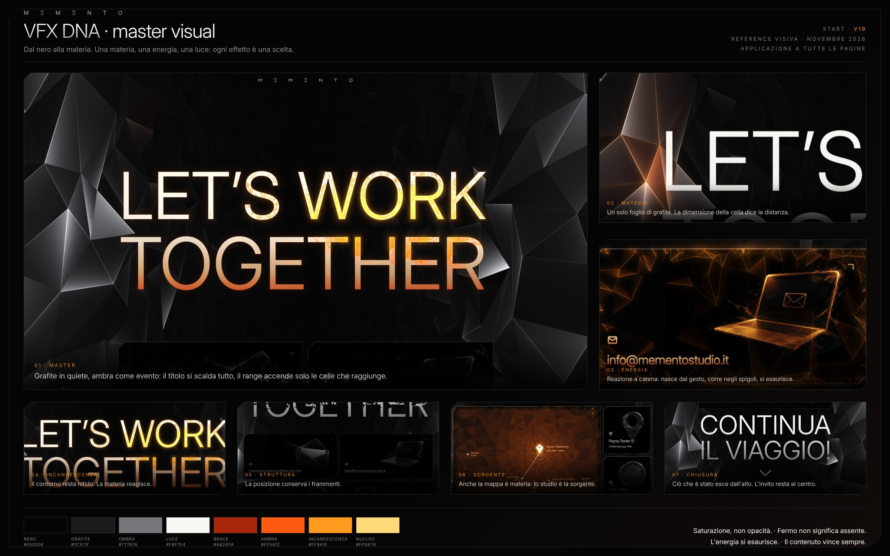

# Memento — VFX DNA

Il DNA visivo e di comportamento degli effetti di mementostudio.it: una sola materia, una sola energia, una sola luce, con regole precise su quando e quanto si mostrano. La pagina START (V19, `mementostart.vercel.app`) è l'implementazione di riferimento; navigation, servizi, Portfolio e levelup la seguiranno con le stesse regole e le stesse costanti.

Questo sistema serve a tre lettori. Il designer ci trova principi, palette, stati e la tavola master. Lo sviluppatore ci trova le costanti e dove vivono nel codice (`codice.md`). Un agente che costruisce una nuova pagina parte da qui, poi legge le sezioni nell'ordine sotto.

## Manifesto

**Dal nero alla materia.** Tutto nasce dal nero e torna al nero. Una rete di celle triangolari diventa grafite, poi contenuto. L'ambra è l'energia che il gesto accende nella materia: arriva, corre negli spigoli e si esaurisce. Nessun effetto esiste "giusto per": ognuno risponde a una di queste tre domande. Dove sono (struttura)? Cosa posso toccare (energia)? Cosa conta (luce)?

## Le tre sostanze

| Sostanza | Ruolo | Dove vive | Mai |
| --- | --- | --- | --- |
| **Nero** | il vuoto, il riposo, la pagina | sfondo, pannelli, il centro dello sfondo | grigio piatto, sfumature colorate |
| **Grafite** | la materia: celle triangolari irregolari, lucide sugli spigoli | pareti dello sfondo, card, glifi, mappa, frammenti | texture fotografiche, rumore senza struttura |
| **Ambra** | l'energia: reazione a catena, incandescenza | solo dove c'è un gesto, un caricamento, una sorgente | a riposo, come colore decorativo, su grandi superfici piene |

Il bianco caldo (`testo-luce`) è l'informazione: i testi. Non è una sostanza degli effetti.

## Gli otto principi

1. **Dal nero alla materia.** Il caricamento costruisce la rete (scia, reticolo, facce, contenuto). Nulla appare con una dissolvenza generica.
2. **Una materia sola.** Sfondo, card, glifi, mappa e frammenti condividono la stessa topologia: triangoli di Delaunay irregolari, di misure miste. Cambia solo la scala.
3. **La scala dice la distanza.** Nello sfondo una cella grande è vicina e una piccola è lontana. Non si mescolano scale a caso.
4. **L'ambra è un evento.** Mai a riposo. Nasce da un gesto, si propaga per celle, si spegne con un suo tempo. Mai un disco che segue il puntatore.
5. **Saturazione, non opacità.** Ci sono tre livelli: quiete (0%), base attiva (80%, tutta la superficie sotto il gesto si scalda) e range (100%, solo le celle raggiunte, con micro-faccette e luce sul bordo).
6. **Il contorno resta nitido. La materia reagisce.** Sagome di testi, icone e card non si deformano mai: l'effetto sta dentro e attorno.
7. **La posizione conserva i frammenti. L'energia si esaurisce.** Lo scroll frammenta per posizione e in monocromo; l'ambra non partecipa allo scroll.
8. **Il contenuto vince sempre.** La colonna dei contenuti ha lo sfondo più scuro, le reazioni dello sfondo lì restano basse, le pareti non superano mai il bianco del titolo.

Due corollari dalle tavole: *fermo non significa assente* (a cursore fermo c'è un impulso e un'eco, poi silenzio) e *un unico campo* (card vicine condividono il range, i bordi rispondono localmente).

## Sezioni

1. `materia.md`: il foglio di grafite, le celle, le luci, la prospettiva.
2. `energia.md`: la reazione a catena, i tre livelli, il range, le sorgenti, il budget d'ambra.
3. `luce-e-incandescenza.md`: luce dei bordi, glow dei testi, bloom.
4. `tipografia.md`: gradiente di quiete, base attiva, range, interlinea.
5. `immagini-e-mappa.md`: grading delle foto, produzione delle immagini, la mappa nella materia.
6. `struttura-e-scroll.md`: le fasce, il caricamento, la deriva, prima e ultima schermata.
7. `movimento.md`: tempi e curve, tutti in una tabella.
8. `interazione-e-accessibilita.md`: puntatore, touch, tastiera, reduced motion, profili di qualità.
9. `applicazione-alle-pagine.md`: cosa resta fisso e cosa cambia su navigation, servizi, Portfolio, levelup.
10. `tavole.md`: quali tavole del concept sono canoniche e quali superate.
11. `codice.md`: dove vive ogni costante, come si registra una superficie, checklist per una nuova pagina.

## Master visual

La tavola `memento-vfx-dna-master-visual.jpg` è il riferimento visivo unico. Mostra la START in hover, la materia, l'energia su una card, l'incandescenza del titolo, la struttura dello scroll, la mappa come sorgente e la chiusura. Le immagini sono render reali dell'engine V19, non illustrazioni.

## Da fare e da evitare

- **Sì:**
  - Celle irregolari di misure miste.
  - Ambra che corre negli spigoli e si spegne.
  - Sagome stabili.
  - Bianco caldo per i testi.
  - Nero vero.
  - Un solo contesto WebGL e un solo loop per pagina.
- **No:**
  - Dischi di luce che seguono il cursore.
  - Ambra a riposo.
  - Superfici grandi piene d'ambra.
  - Lampeggi continui.
  - Glow a gradini.
  - Gradienti blu o viola.
  - Effetti diversi per pagine diverse senza una ragione scritta qui.

## Fonti

- Tavole del concept: `x.zip`, 200 tavole, novembre 2026. La sezione `tavole.md` dice quali restano valide.
- Implementazione: `memento-start` V19, `src/vfx/` (config, shader, engine).
- Font: Inter (licenza SIL OFL 1.1), file variabile in `fonts/`.
